<div align="center">

# ☁️ CLF-C02 Study Arcade

**Flashcards and study games for the AWS Certified Cloud Practitioner exam,<br>built straight from a study-guide spreadsheet.**


<picture>
  <source media="(prefers-color-scheme: dark)" srcset="docs/home-dark.png">
  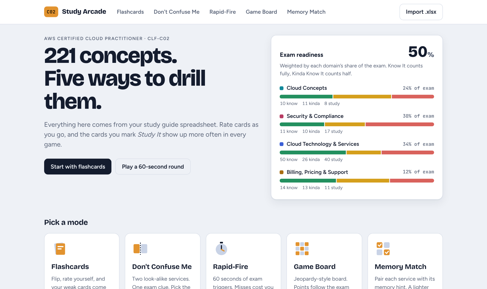
</picture>

</div>

## Seven ways to study

<table>
  <tr>
    <td width="50%" valign="top">
      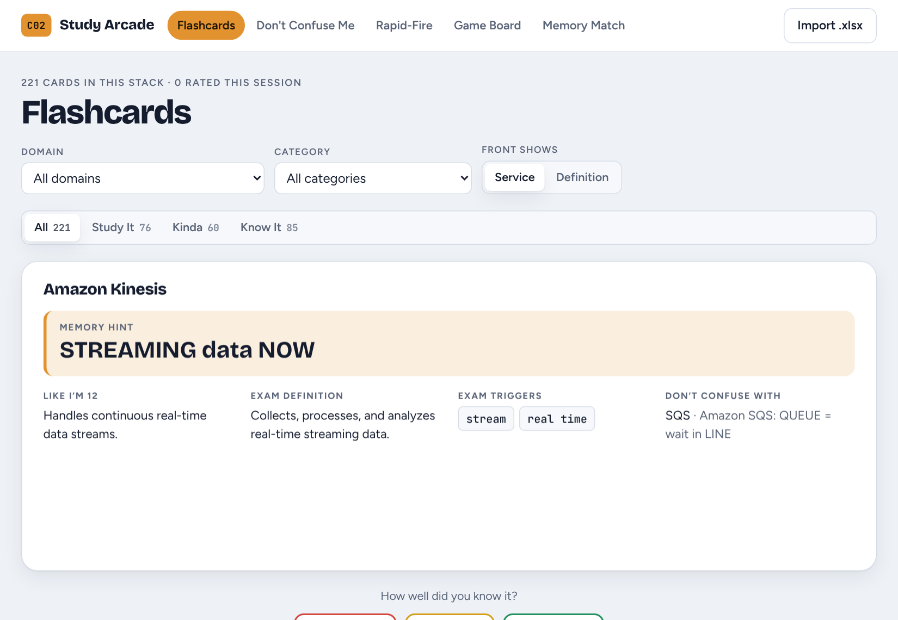
      <h3>🃏 Flashcards</h3>
      Flip, then rate yourself <b>Study It · Kinda · Know It</b>. Cards you're weak on come back up to 4× as often. Flip direction, filter by domain or category.
    </td>
    <td width="50%" valign="top">
      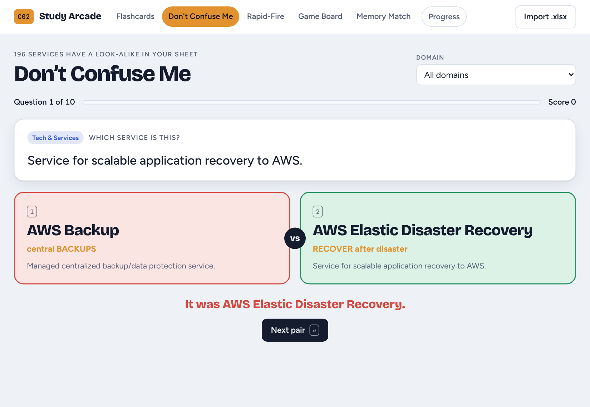
      <h3>🥊 Don't Confuse Me</h3>
      One exam clue, two look-alikes from your <i>Don't Confuse With</i> column. CloudTrail or CloudWatch? SQS or SNS? Rounds of 10.
    </td>
  </tr>
  <tr>
    <td width="50%" valign="top">
      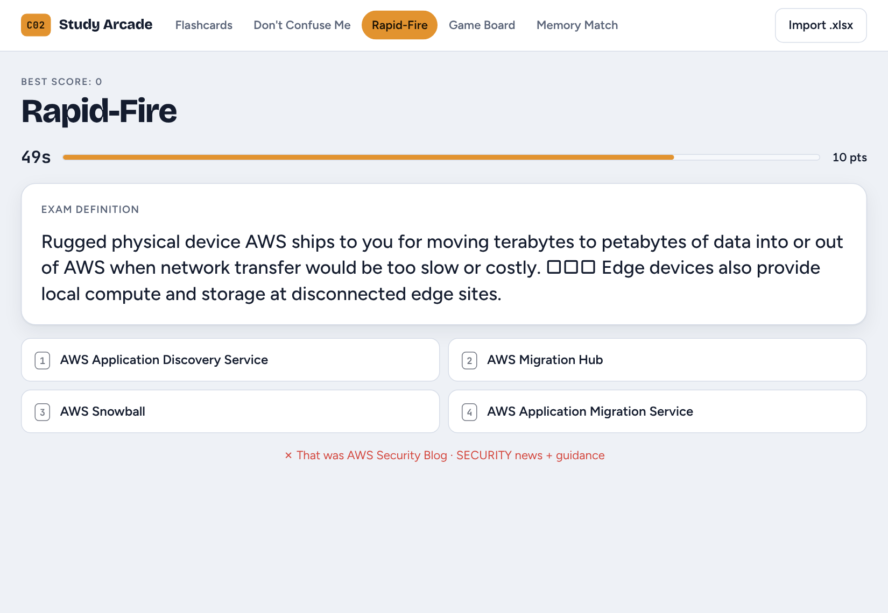
      <h3>⏱️ Rapid-Fire</h3>
      60 seconds, four options, wrong answers pulled from the same category. Streaks multiply your score; misses cost 3 seconds.
    </td>
    <td width="50%" valign="top">
      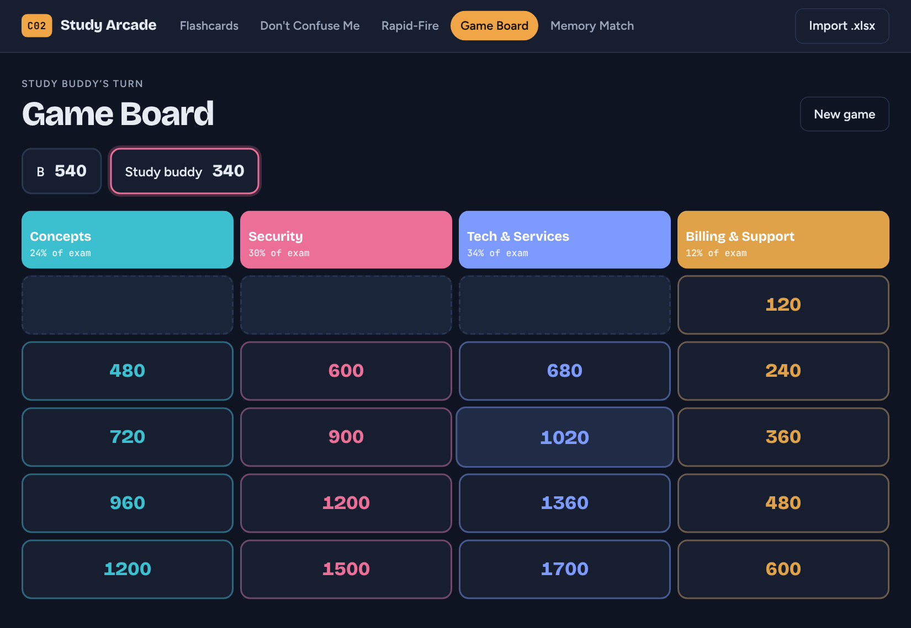
      <h3>🎯 Game Board</h3>
      Jeopardy-style, one column per exam domain. Tile values follow each domain's exam weight. Solo or pass-and-play for up to 4.
    </td>
  </tr>
  <tr>
    <td width="50%" valign="top">
      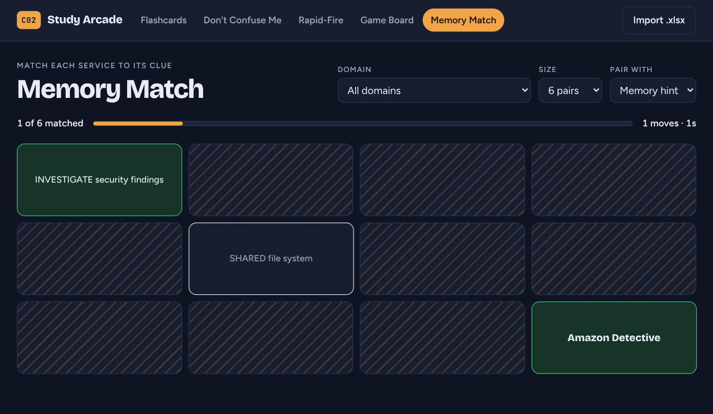
      <h3>🧩 Memory Match</h3>
      Pair each service with its memory hint or its “explain like I'm 12” line. A lighter review for tired brains.
    </td>
    <td width="50%" valign="top">
      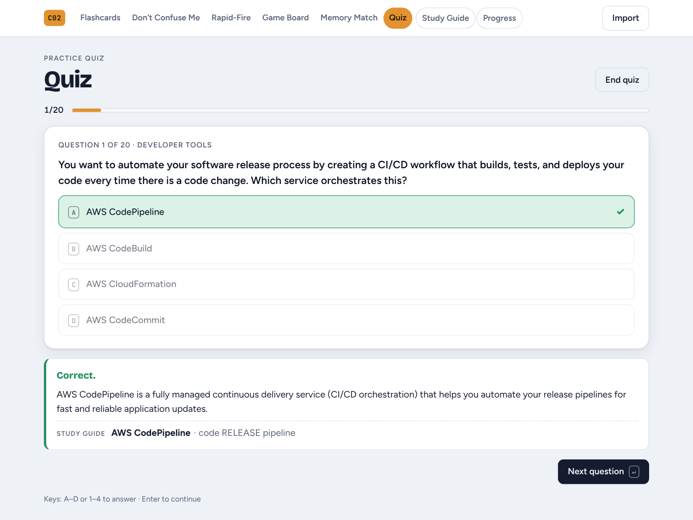
      <h3>📝 Quiz</h3>
      Exam-style questions with the answer and <i>why</i> after each one, or a timed <b>exam simulation</b> (90 minutes per 65 questions) with flagging and review at the end.
    </td>
  </tr>
  <tr>
    <td colspan="2" valign="top">
      <h3>🧠 It learns what you don't know</h3>
      Missing a question in any game moves that card down a confidence level, so it comes back more often everywhere.
      <br><br>
      The home screen turns your ratings into an <b>exam-readiness score</b>, weighted by how much each domain counts on the real exam.
      <br><br>
      Works offline, in light and dark mode, and on your phone.
    </td>
  </tr>
</table>

## 📝 Quiz

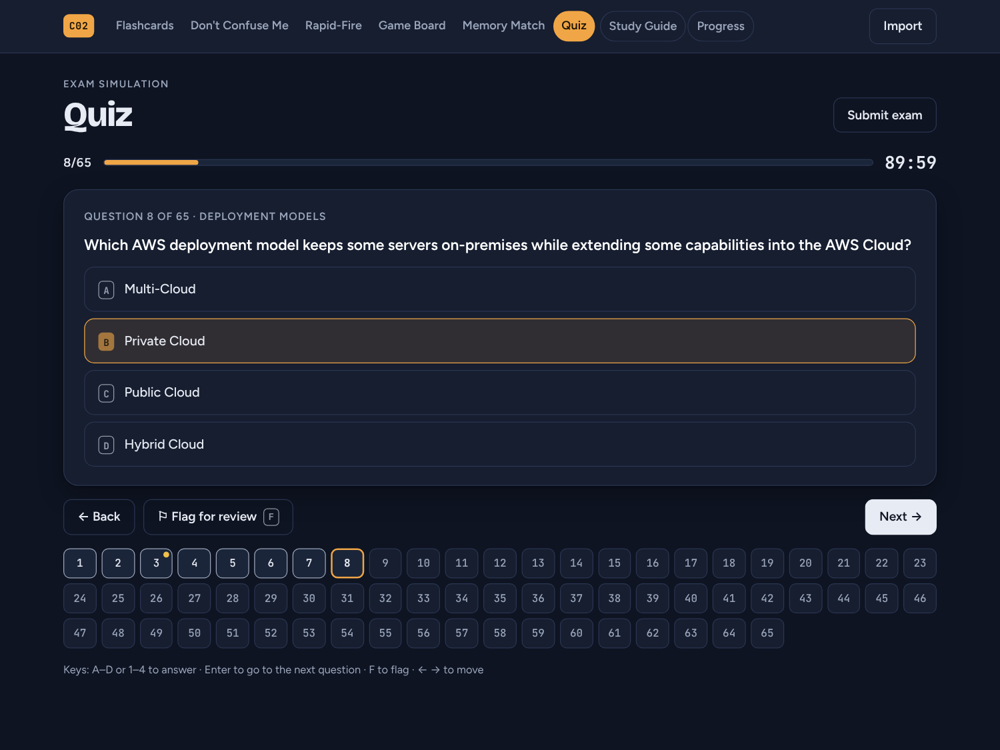

- **Practice:** answer, see right or wrong right away, read why, and see which study-guide concept it tests
- **Exam simulation:** timed at the real pace (90 minutes per 65 questions), flag questions, jump around, submit for a score
- **Pick the pool:** 10, 20, 65 or all questions; all, not tried yet, or ones you've missed; filter by exam domain
- **Results:** score against the ~70% passing line, accuracy by domain, a review of every miss, and one click to retry the ones you got wrong
- Each answer also counts toward the concept it tests, so missed questions show up in Progress and come back in the other games

### Adding questions

Questions live in [`data/questions/`](data/questions). Any number of `.xlsx` files, one question per row:

| Question | Answer A | Answer B | Answer C | Answer D | Correct Answer | Concept Covered | Description on why its the right answer | Related Concept *(optional)* | Priority *(optional)* |
| --- | --- | --- | --- | --- | --- | --- | --- | --- | --- |

- Add `Answer E`, `Answer F` for longer lists. For multiple-response questions, put several letters in **Correct Answer** (`B, D`) and the quiz asks you to choose that many.
- **Priority** *(optional)*: put `⚪ Low Priority – reason` to hide a question (retired service, not on the in-scope list) unless low priority is switched on.
- **Answer A Explanation**, **Answer B Explanation**… *(optional)*: why each choice is right or wrong. After you answer, the Quiz lists why every other choice is wrong, and the Questions Guide shows them under **Show the question**.
- **My Answer** *(optional)*: what you picked the first time (e.g. on a practice test). The Quiz reminds you after you answer.
- **Practice Test** *(optional)*: where the question came from, shown in the Questions Guide.
- **Related Concept** is a name from the study guide. Leave it blank and the app works it out from the correct answer.
- The same question in two files counts once.

Questions you shouldn't publish (for example from a paid practice exam) go in `data/private/` instead. That folder is git-ignored: `npm run sync` builds them into your local copy only, and the GitHub Pages build never sees them.

Then either click **Import** in the app and pick the file (it's recognized as a question sheet and added to the quiz in that browser), or drop it in `data/questions/` and run `npm run sync` to build it in for everyone.

## 📚 Questions Guide

<picture>
  <source media="(prefers-color-scheme: dark)" srcset="docs/questions-guide-dark.png">
  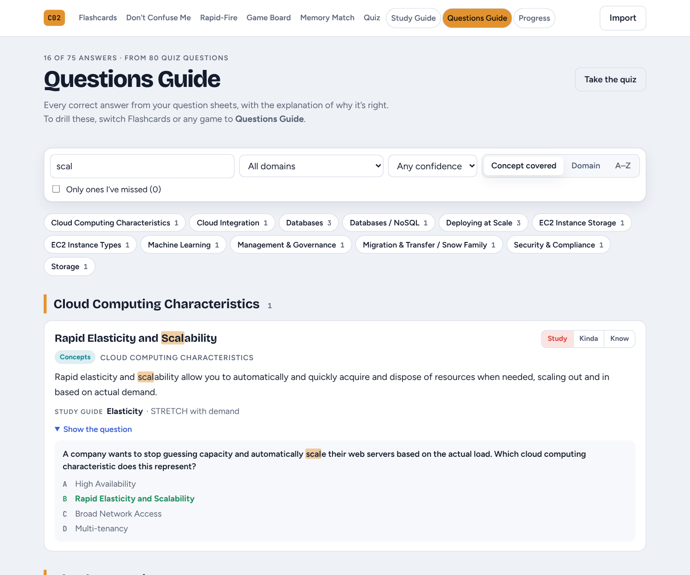
</picture>

A second study page built only from your question sheets. Each correct answer is an entry: the answer is the title, **"Description on why its the right answer"** is the explanation, and **Concept Covered** is the label. When the answer is a phrase ("Test recovery procedures"), the entry uses the concept's name instead ("Reliability Pillar").

- Group by Concept Covered, exam domain or A–Z, search answers, explanations and questions, and jump to any section from a searchable **Jump to section** dropdown
- **Show the question** opens the original question with every choice and the right one marked
- Questions with the same answer share one entry, with each explanation listed
- Your quiz record on each entry, plus an **Only ones I've missed** filter

### Study these in Flashcards and the games

Flashcards, Don't Confuse Me, Rapid-Fire, the Game Board, Memory Match and Progress all have a **Studying: Study Guide / Questions Guide** switch. On the Questions Guide deck:

- **Flashcards** show the answer, why it's right, the wrong choices from the quiz and the question it came from
- **Don't Confuse Me** pits the right answer against a wrong choice from the same question
- **Memory Match** pairs each answer with the first line of its explanation

## 🔤 Vocab Guess

A guessing game built from [`data/vocab/`](data/vocab), a 288-term vocabulary sheet (TERM, DEFINITION, CATEGORY, THINK — MEMORY CLUE, STUDY PRIORITY, EXAMPLE QUESTION).

1. **Definition** — name the term from its definition
2. **Hint** — reveal the *Think of…* memory clue
3. **Example question** — reveal an exam-style question whose answer is the term (from the quiz bank when one exists, otherwise the sheet's EXAMPLE QUESTION column)

Guess by **picking from 4** (look-alikes from the same category) or by **typing it** (close spellings and abbreviations like "AZ" or "RPO" count). Scoring: **3** points with just the definition, **2** after the hint, **1** after the example, **0** if wrong. Missed terms come back more often, and the terms also appear as a **Vocab** deck in Flashcards, the games and Progress.

## ★ Focus deck (temporary)

A separate 60-card deck aimed at the topics I kept missing on practice tests: which security service does what, encryption, shared responsibility edge cases, storage choices, VPC networking, and billing tools. It lives in [`data/focus/`](data/focus) (same columns as the study guide) and shows up as **★ Focus** in the *Studying* switch for Flashcards, every game and Progress.

**To remove it:** delete the file in `data/focus/` and run `npm run sync`. The ★ Focus option disappears when the folder is empty. To make a new one, drop a different sheet in the same folder.

## 📖 Study Guide page

<picture>
  <source media="(prefers-color-scheme: dark)" srcset="docs/study-guide-dark.png">
  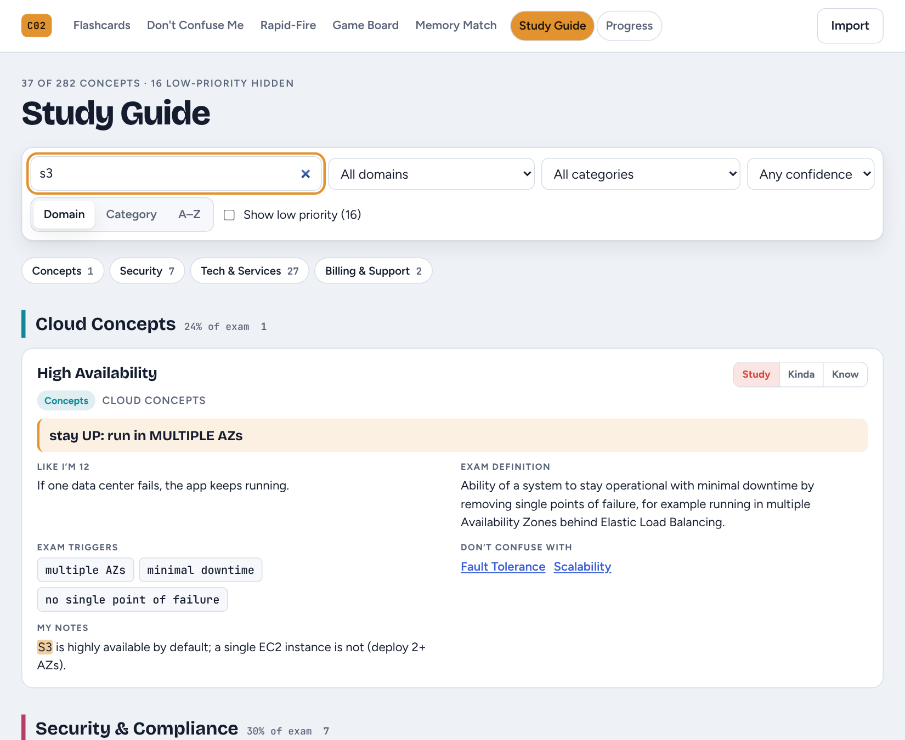
</picture>

The whole spreadsheet as one readable page. Every concept shows its memory hint, "like I'm 12" line, exam definition, official AWS definition (with source link), exam triggers, look-alikes and your notes.

- **Search** across names, definitions, triggers and notes, with matches highlighted
- **Filter** by domain, category or confidence, and **group** by domain, category or A–Z
- **Jump** to any look-alike by clicking it in *Don't confuse with*
- **Rate** each concept Study / Kinda / Know right from the page
- Low-priority (out-of-scope) concepts stay hidden unless you turn them on

## 📈 Progress tracking

<picture>
  <source media="(prefers-color-scheme: dark)" srcset="docs/progress-dark.png">
  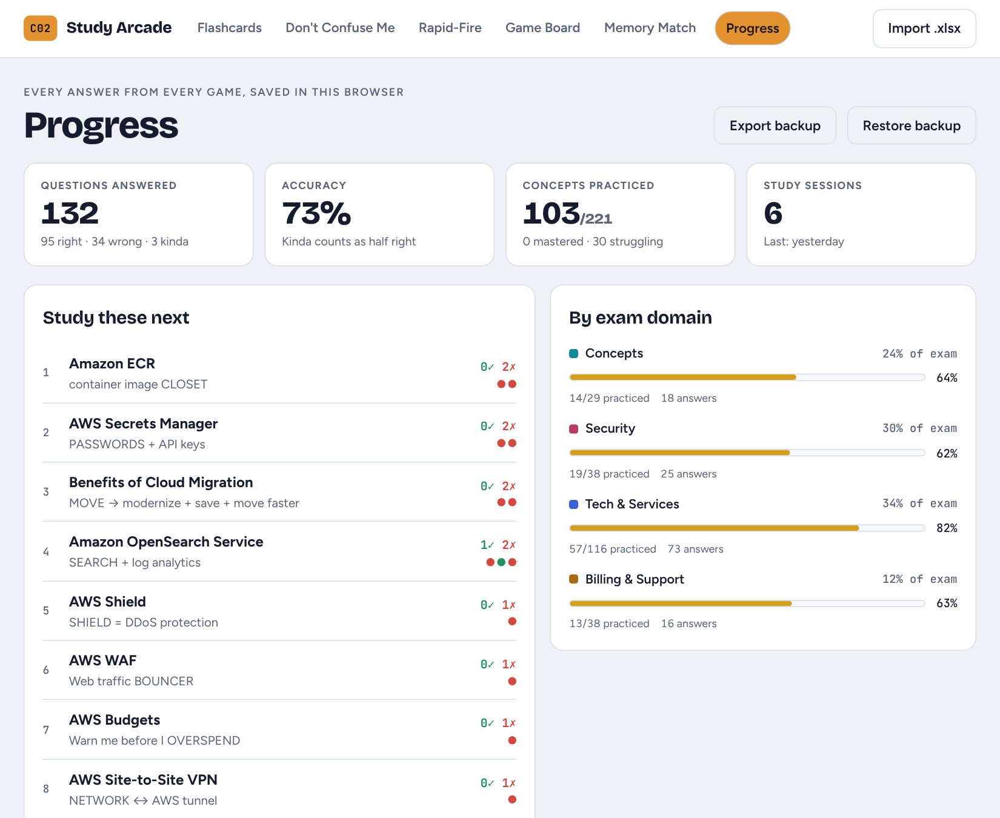
</picture>

Every answer in Flashcards, Don't Confuse Me, Rapid-Fire, the Game Board and the Quiz is recorded. The **Progress** tab shows:

- **Totals:** questions answered, accuracy, concepts practiced and study sessions
- **Study these next:** the concepts you miss most, ranked by misses, accuracy and recent mistakes
- **By exam domain:** your accuracy in each domain next to its exam weight
- **Recent sessions:** when you studied, which mode, right/wrong and what you missed
- **All concepts:** a sortable, searchable table of every concept, with right/wrong counts, accuracy, your last 8 answers and a status (Not practiced → Struggling → Learning → Mastered)

A session is one stretch of play in one mode. Switching modes or 30 idle minutes starts a new one.

### Where your data lives

Everything is saved in your browser's `localStorage`. No account, no server, no cost, and nothing leaves your device. That also means history is per browser, so use **Export backup** on the Progress page to save a `.json` file, and **Restore backup** to load it on another device or after clearing your browser data.

## Quick start

```bash
npm install
npm run dev
```

Open http://localhost:5173. Keyboard: <kbd>Space</kbd> flips · <kbd>1</kbd>–<kbd>4</kbd> answer · <kbd>Enter</kbd> continues.

## Adding concepts

The whole app is driven by [`data/AWS CLF-C02 Study Guide.xlsx`](data/). Add rows, then either:

| | How | Good for |
| --- | --- | --- |
| **Import in the app** | Click **Import** and pick the file | Quick updates. Saved in that browser |
| **Bake it in** | Replace the file in `data/` and run `npm run sync` | Making it the default for everyone |

Your ratings are kept either way.

<details>
<summary><b>Spreadsheet columns</b></summary>
<br>

Columns are matched by header name, so order doesn't matter and extra columns are ignored.

| Column | Used for |
| --- | --- |
| `AWS Product / Concept` | Card name *(required)* |
| `Exam Definition` | Card back and game clues *(required)* |
| `⭐ Memory Hint` | Flashcards, Memory Match |
| `Explain Like I'm 12` | Flashcards, Game Board, Memory Match |
| `Key Exam Words / Trigger` | Rapid-Fire and Game Board clues. Separate with `;` |
| `Don't Confuse With` | Look-alike pairs and wrong answers. Separate with `;` |
| `CLF-C02 Domain` | Filters and Game Board columns |
| `Category` | Filters, and picks believable wrong answers |
| `Confidence` | 🔴 Study It · 🟡 Kinda Know It · 🟢 Know It · ⚪ Low Priority |
| `Official Exam Guide Coverage` | ⚪ Out of Scope rows are hidden unless you turn them on |
| `My Notes` | Shown on the card back and after a miss |
| `Official AWS Definition` | Quoted from AWS documentation, shown on the card back |
| `Official Source` | Link to the AWS page each official definition came from |

The **Exam Info** sheet sets the domain weights and **Exam Cheat Sheet** adds extra Rapid-Fire prompts.
</details>

<details>
<summary><b>Project structure</b></summary>
<br>

```
data/                      the study guide spreadsheet
data/questions/            practice-question spreadsheets for the Quiz
scripts/sync-data.mjs      spreadsheets → src/data/studyGuide.json + questions.json
src/
  lib/parseWorkbook.js     reads the .xlsx (shared by the app and the sync script)
  lib/deck.js              look-alike matching, weighted picks, question building
  lib/parseQuestions.js    reads question sheets (single and multiple-response)
  lib/quiz.js              links questions to concepts, builds rounds, quiz history
  lib/stats.js             answer history, sessions, mastery rules
  lib/storage.js           ratings, history, imported deck and best scores (localStorage)
  lib/questionCards.js     turns quiz answers into Questions Guide cards
  modes/                   one file per study mode, plus Guide, QuestionsGuide and Progress
  styles.css               light and dark theme tokens and all styles
```
</details>

## Deploy to GitHub Pages

A workflow in `.github/workflows/deploy.yml` builds and publishes the site on every push to `main`. One-time setup:

1. Go to the repo's **Settings → Pages**.
2. Under **Build and deployment → Source**, choose **GitHub Actions**.
3. Push to `main` (or run the workflow from the **Actions** tab).

The site goes live at `https://<your-username>.github.io/AWSGuide/`.

> GitHub Pages is free for **public** repos. A private repo needs a paid GitHub plan, and the published site is public either way.

Other build options:

```bash
npm run build          # static site in dist/ (works on any static host)
npm run build:single   # one self-contained HTML file in dist-single/
```

---

<sub>A personal study tool. Not affiliated with or endorsed by Amazon Web Services.</sub>
